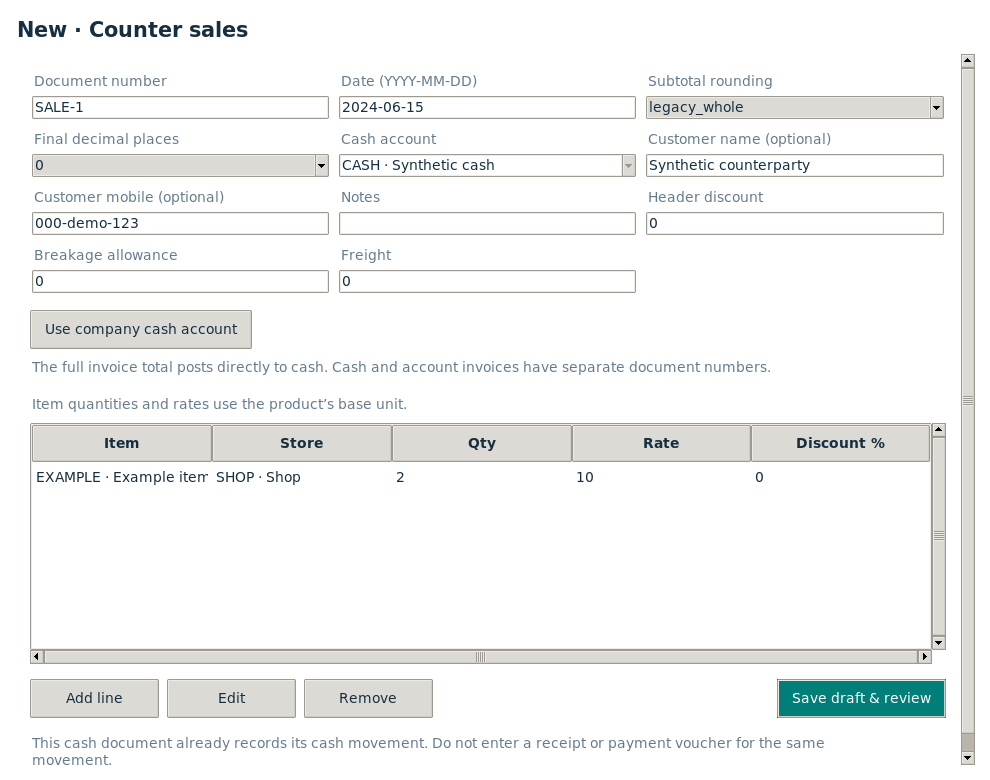
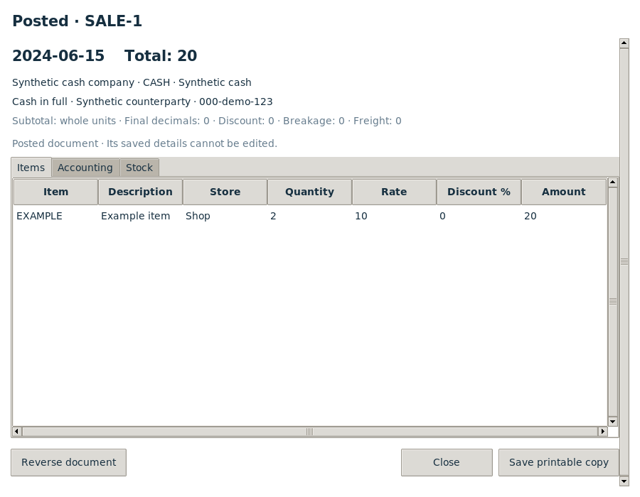
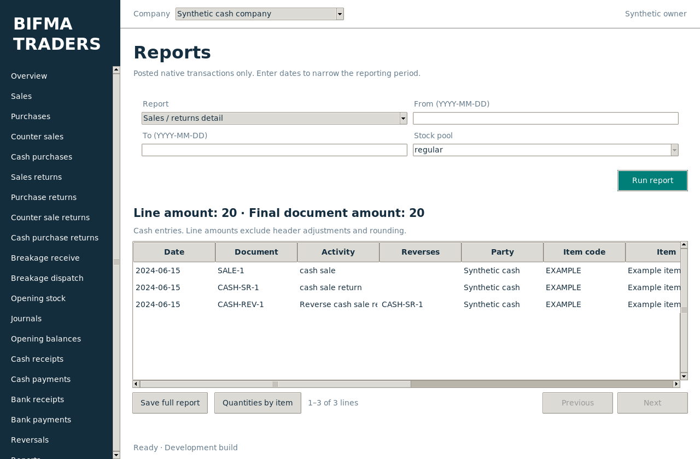

# Counter sales and cash purchases

Source version `0.3.0.dev4` adds explicit fully settled cash trades. These use a
separate native database, corrected balanced postings and immutable snapshots.
They do not change the recovered archive or reclassify existing native invoices.
Original screen/print comparison and target-machine acceptance remain open.

## Source evidence and posting

The recovered `SALE_COUNTER` menu and `S_TYPE='C'` ledger branch support direct
cash sales. `P_TYPE='C'` likewise selects cash on the purchase/return side.
The source uses a hardcoded cash code for trades and the company's configured
cash account for vouchers. Both configured accounts match that code in this
backup. New cash trades use the operator's explicit company cash configuration.
See [recovered formulas](LEGACY_ANALYSIS.md).

A count-only inspection found five cash sales and one document-number overlap
between cash and credit sales. All five affect regular stock; two contain zero-priced
goods and have no financial postings. The received amount is populated on three,
each equal to the full cash debit. That field is absent from the ledger formula,
and no invoice-to-receipt relationship or receipt-generating routine was recovered.
These facts establish full cash posting, not tender/change or partial-payment policy.

| Native kind / screen | Cash effect | Stock effect | Permission |
| --- | --- | --- | --- |
| `cash_sale` / Counter sales | Debit cash; credit sales allocations | Regular stock out | `counter_sales` |
| `cash_purchase` / Cash purchases | Credit cash; debit purchase allocations | Regular stock in | `purchases` |
| `cash_sale_return` / Counter sale returns | Credit the original cash account; debit original sales allocations | Regular stock in | `sales_returns` |
| `cash_purchase_return` / Cash purchase returns | Debit the original cash account; credit original purchase allocations | Regular stock out | `purchase_returns` |

Every cash kind has its own number namespace per company. An account sale and a
counter sale can both be numbered `1`; two counter sales in that company cannot.
Header discounts and other supported adjustments apply once through the same
exact allocation engine as ordinary trades. A zero total creates no fabricated
journal entries while positive item quantities still move stock.

## Entry, returns and correction

Configure an active, postable account with kind **cash** in the company's **Cash
account** field. Counter sales and cash purchases show that account as a fixed
header choice. **Use company cash account** explicitly refreshes an edited draft
from the setup loaded when its editor opened. A configuration change before
posting forces resave and review; it cannot redirect a reviewed posting silently.

The original cash invoices optionally accept a customer/supplier name and mobile.
They are saved receipt contacts, not a new ledger account. Names are limited to
150 characters, mobile text to 80; text is trimmed and leading zeros are retained.
The normal item, store, base-unit quantity, rate, percentage discount and rounding
controls apply. **Save draft & review** exposes the exact cash and stock entries.

Post the cash invoice once. Its total already posts to cash, so an additional
receipt/payment voucher for that same movement would double-count it. Partial
account payments continue to use ordinary invoices plus separate vouchers.
Tendered cash, change, split payment, retained overpayment and invoice allocation
are not implemented or inferred from the old received-amount field.

Cash returns must select a posted corresponding cash original. They preserve its
cash binding and receipt contacts; they never choose today's company cash account.
The original account must still be active, postable and of kind cash. The existing
same-company/party/item/store/rate/unit, date, quantity and money limits apply.
Header-adjusted originals still require the owner's unresolved refund policy.
Standard and cash returns cannot consume each other's invoice lines.

A reversal retains its original cash account, labels, contacts and exact effects,
even if company cash setup later changes. An invoice with an active linked return
cannot be reversed before that return. Posted documents remain immutable.

## Reports, output and access

Sales/purchase detail reports now offer **Entry type**: Account and cash, Account
entries, or Cash entries, independently of invoices/returns. The filter appears
on screen and in full HTML output. Cash invoice/return/reversal signs use the same
rules as their account counterparts. Header totals and grouped quantities retain
the existing [trade detail contract](TRADE_DETAIL_REPORTS.md).

An all-method sales invoice report requires both `sales/read` and
`counter_sales/read`; adding returns also requires `sales_returns/read`.
Cash-only invoices require only `counter_sales/read`. Purchase activity uses the
existing purchase/return grants. Every selected grant is checked again before
publishing a report. Selectors follow exactly the same access and kind scope.

The service API adds `payment_mode='account'|'cash'|'all'` to `trade_detail`,
`trade_selectors` and trade report exports. The default remains `account` for
existing callers. The UI offers only currently authorized combinations. Existing
generic invoices that happened to use a cash account are not retroactively
classified as explicit cash documents.

Printable cash documents show their saved cash account, full cash amount,
optional receipt contacts and applicable original/return/reversal references.
No current setup, tender, due amount or invoice allocation is substituted into
issued facts. Malformed or inconsistent cash snapshots fail before publication.

## Native schema upgrade

Migration 4 expands the supported document kinds while preserving the original
per-kind unique-number constraint. It rebuilds the documents table in one checked
transaction, retaining row IDs, all fields, snapshots, journal/stock references,
indexes, views and immutability guards. Migrations 1–3 retain their exact checksums.
A verified backup precedes every actual upgrade; there is no automatic upgrade
when opening a file and no promotion of historical Oracle data.

The bounded migration connection disables foreign-key enforcement before its
transaction, follows SQLite's [generalized table-rebuild procedure](https://www.sqlite.org/lang_altertable.html#making_other_kinds_of_table_schema_changes),
and checks every foreign key before commit. Enforcement is restored on success
and failure. Public native sessions still require foreign keys and recursive
guards; no weaker connection mode is exposed to application services.

Focused synthetic tests cover preserved populated v3 state/backup, earlier
migration checksums, duplicate namespaces, surviving guards, rollback, orphan
refusal and a real subprocess interruption after dropping the old table.
Recovery must restore the exact v3 logical state, after which upgrade can retry.
Cash transaction and export tests cover configuration changes, permissions,
zero-value goods, immutable contacts, returns, reversals and no double posting.

## Synthetic UI examples

These captures use generated records. They verify the rendered entry, saved cash
summary and report controls in the Linux source runtime; target display/font
acceptance remains separate.
